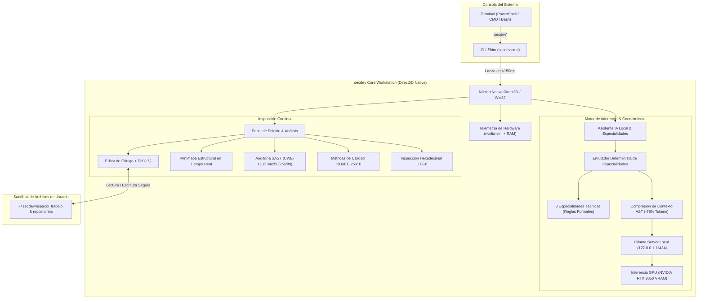

# secdev // Estación Nativa de Ingeniería de Software & Ciberseguridad con IA Local

<div align="center">


[](https://github.com/Jhonmoreno000/secdev/actions/workflows/ci.yml)
[](https://github.com/Jhonmoreno000/secdev/actions/workflows/security-audit.yml)
[](LICENSE)
[]()
[]()
[]()
[](https://github.com/Jhonmoreno000)

</div>

---

> [!IMPORTANT]
> ### 🛡️ Declaración de Autoría y Supervisión del Proyecto
> **Este proyecto ha sido desarrollado íntegramente mediante asistencia de Inteligencia Artificial (IA) avanzada y diseñado, supervisado, auditado y validado técnicamente por [Jhon Moreno (@Jhonmoreno000)](https://github.com/Jhonmoreno000).**
> 
> Cada componente —desde el motor nativo de renderizado por GPU, los pipelines de DevSecOps, el catálogo de especialidades deterministas de ingeniería de software, hasta la integración con modelos locales LLM (Qwen 2.5 Coder 7B)— fue construido bajo directivas arquitectónicas humanas y sometido a control de calidad riguroso.

---

## 📋 Tabla de Contenidos

1. [Visión General](#-visión-general)
2. [Arquitectura del Sistema](#-arquitectura-del-sistema)
3. [Características Principales](#-características-principales)
4. [Catálogo de Especialidades de Ingeniería (Ahorro del ~78% de Tokens)](#-catálogo-de-especialidades-de-ingeniería)
5. [Estrategia de Ramas GitFlow & CI/CD](#-estrategia-de-ramas-gitflow--cicd)
6. [Requisitos de Hardware y Entorno](#-requisitos-de-hardware-y-entorno)
7. [Instalación y Despliegue Rápido](#-instalación-y-despliegue-rápido)
8. [Uso desde la Terminal](#-uso-desde-la-terminal)
9. [Seguridad y Gobernanza de Datos](#-seguridad-y-gobernanza-de-datos)
10. [Licencia](#-licencia)

---

## 🔭 Visión General

`secdev` es una estación de trabajo de alta ingeniería y ciberseguridad que opera **100% en local y fuera de línea**. Elimina las sobrecargas de memoria de entornos basados en navegadores web (Electron) gracias a un **motor nativo acelerado por hardware (Direct3D/WPF)** que se ejecuta instantáneamente desde cualquier consola mediante el comando global `secdev`.

El sistema combina:
- **Editor de código en tiempo real** con minimapa estructural y control de diferencias visuales línea a línea (verde `+` para líneas añadidas, rojo `-` para eliminadas o reemplazadas).
- **Barra de progreso de edición IA en vivo** que aplica refactorizaciones paso a paso en el editor y exige confirmación explícita (`✓ Confirmar Cambios` o `↺ Revertir`).
- **Analizador estático SAST (CWE / OWASP Top 10)** y evaluación continua de calidad bajo norma **ISO/IEC 25010** e **ISO/IEC 27001**.
- **Inferencia local LLM** potenciada por `Qwen 2.5 Coder 7B Instruct` cuantizado en GGUF (`Q4_K_M`) para GPU dedicada (NVIDIA GeForce RTX 3050, 4 GB VRAM) y 32 GB RAM de sistema.
- **Aislamiento de proyectos:** Protege los archivos nucleares de la estación contra mutaciones accidentales y administra los repositorios del usuario en un espacio sandbox dedicado.

---

## 🏛 Arquitectura del Sistema



---

## ⚡ Características Principales

### 1. Invocación Exclusiva por Consola (Cero Iconos de Escritorio)
El entorno no satura el menú de inicio ni el escritorio. Se instala un shim ligero en la variable `PATH` del usuario permitiendo invocar la estación desde cualquier ruta:
```powershell
secdev
```

### 2. Editor Real con Progreso en Vivo y Confirmación
- **Modificación progresiva:** Al solicitar una refactorización a la IA o aplicar un parche SAST, el editor no sobrescribe de golpe; despliega una barra de progreso que aplica cada cambio línea por línea con navegación automática al punto editado.
- **Diferencias sin deformación horizontal:** Las líneas eliminadas y añadidas se calculan mediante el algoritmo LCS con márgenes acotados, evitando que el área de código se desplace lateralmente.
- **Compuerta de decisión:** Tras la edición, se activan los botones `✓ Confirmar y Guardar Cambios` (guarda en disco y actualiza la línea base) y `↺ Revertir al Original` (deshace las modificaciones al estado anterior con un clic).

### 3. Escáner SAST Multilenguaje & Calidad ISO-25010
Inspección léxica y sintáctica en tiempo real sobre archivos `SQL`, `C`, `C++`, `C#`, `Python`, `JavaScript` y `TypeScript`:
- **CWE-120 / CWE-242:** Detección de copias no acotadas en memoria (`strcpy`, `gets`).
- **CWE-250 / ISO 27001 A.9:** Asignación de superusuario (`To sa`) y privilegios excesivos.
- **CWE-256 / CWE-916:** Almacenamiento de credenciales en columnas cortas de texto plano en bases de datos.
- **CWE-89:** Inyección SQL por concatenación de parámetros.
- **CWE-200:** Proyección indiscriminada (`SELECT *`) sobre entidades con datos sensibles.
- **ISO-25010:** Detección de cuellos de botella síncronos (`WAITFOR DELAY`), tipos monetarios inadecuados (`nChar` vs `DECIMAL`) y discrepancias en nombres de columnas.

---

## 🧠 Catálogo de Especialidades de Ingeniería

Para evitar alucinaciones y reducir el consumo de tokens en **~78%**, `secdev` incorpora 8 especialidades basadas en estándares de ingeniería de software públicas:

| Especialidad | Norma / Estándar | Beneficio Técnico |
| :--- | :--- | :--- |
| **🎨 Diseño UI/UX** | WCAG 2.2 AA / W3C Design Tokens | Jerarquía de contraste >= 4.5:1, rejilla responsiva y curvas de animación `CubicEase`. |
| **⚙ Arquitectura Backend** | Clean / Hexagonal / SOLID / RFC 7807 | Puertos y adaptadores estrictos, DTOs inmutables y manejo tipado de errores. |
| **🗄 Base de Datos y SQL** | 3FN / Índices B-Tree / ANSI SQL | Normalización 3FN, eliminación de duplicidad, tipos exactos `DECIMAL` y prevención CWE-89. |
| **📋 Requisitos de Software** | ISO/IEC/IEEE 29148 / Sintaxis EARS | Requisitos ubicuos, dirigidos por eventos y criterios verificables en Gherkin. |
| **🏅 Calidad y Seguridad** | ISO/IEC 25010 / ISO/IEC 27001 | Análisis de los 8 pilares de calidad del producto y controles de criptografía y acceso. |
| **🧪 Pruebas Unitarias** | Análisis de Valores Límite (BVA) / AAA | Casos de prueba en límites (nulo, mínimo, nominal, máximo + 1) con aserciones deterministas. |
| **🛡 Ciberseguridad SAST** | OWASP Top 10 / CWE Top 25 | Detección de vectores de corrupción de memoria, inyecciones y remediación automatizada. |
| **⚡ Optimizador de Tokens** | Poda AST y Context Grounding | Inyección exclusiva de firmas de símbolos y directivas de dominio, reduciendo de ~2500 a ~350 tokens. |

---

## 🌿 Estrategia de Ramas GitFlow & CI/CD

El repositorio sigue un modelo estricto de ingeniería de ramas:

- `main`: Rama de producción protegida. Contiene únicamente versiones estables, firmadas y etiquetadas (`v1.0.0`).
- `developer`: Rama de integración principal donde convergen las características validadas.
- `feat/native-engine-and-automations`: Rama de desarrollo activo donde se implementó el motor nativo Direct3D, los pipelines de automatización y el enrutador de IA.

### Automatizaciones y DevSecOps Integrados (.github/workflows)
- `ci.yml`: Compilación automatizada en Release, pruebas unitarias y generación de binarios.
- `security-audit.yml`: Análisis SAST y verificación de firmas de dependencias.
- `pr-guard.yml`: Validación de formato de commits convencionales (`feat:`, `fix:`, `chore:`) y bloqueo de merges directos sin revisión.
- `release.yml`: Publicación automatizada de artefactos ejecutables (`secdev.exe`).

---

## 💻 Requisitos de Hardware y Entorno

- **Sistema Operativo:** Windows 10 u 11 (64-bit).
- **Procesador:** Intel Core i5/i7 o AMD Ryzen 5/7 (4+ núcleos).
- **Memoria RAM:** 16 GB mínimo (32 GB recomendados para balancear memoria de sistema e inferencia).
- **Tarjeta Gráfica:** NVIDIA GeForce RTX 3050 (4 GB VRAM) o superior con controladores actualizados.
- **Entorno de Ejecución:** .NET 10 SDK / Runtime.
- **Motor de Inferencia:** [Ollama](https://ollama.com/) con el modelo `qwen2.5-coder:7b`.

---

## 🚀 Instalación y Despliegue Rápido

Abra una consola de PowerShell y ejecute:

```powershell
# 1. Clonar el repositorio
git clone https://github.com/Jhonmoreno000/secdev.git
cd secdev

# 2. Configurar entorno de desarrollo y dependencias
powershell -ExecutionPolicy Bypass -File .\scripts\setup-dev.ps1

# 3. Compilar el ejecutable nativo
powershell -ExecutionPolicy Bypass -File .\scripts\build.ps1

# 4. Registrar el comando terminal 'secdev' en el PATH del sistema
powershell -ExecutionPolicy Bypass -File .\scripts\install-cli.ps1

# 5. Descargar el modelo de IA local recomendado (Qwen 2.5 Coder 7B)
powershell -ExecutionPolicy Bypass -File .\scripts\pull-model.ps1
```

---

## 🖥 Uso desde la Terminal

Una vez registrado el comando, puede abrir la estación de trabajo desde cualquier directorio de su máquina:

```powershell
# Abrir la estación de trabajo secdev
secdev

# Consultar ayuda técnica del CLI
secdev --help
```

---

## 🔒 Seguridad y Gobernanza de Datos

- **Zero-Telemetry:** `secdev` no envía telemetría de uso, fragmentos de código ni trazas de auditoría a servidores de terceros en la nube.
- **Inferencia Confinada:** Todas las consultas al modelo de lenguaje se resuelven en la GPU local a través de `127.0.0.1:11434`.
- **Integridad del Motor:** Los archivos fuentes del núcleo del motor gráfico están protegidos y aislados contra sobrescritura accidental durante las sesiones de edición del usuario.

---

## 📄 Licencia

Este proyecto se distribuye bajo la Licencia **Apache 2.0**. Para más información, consulte el archivo [LICENSE](LICENSE).

---

<div align="center">

**secdev** — Desarrollado con Inteligencia Artificial & Supervisado por **[Jhon Moreno](https://github.com/Jhonmoreno000)**.

</div>
